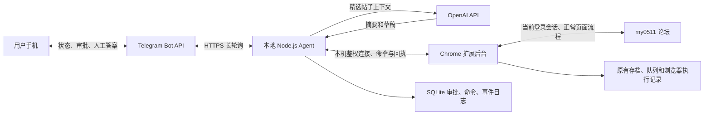
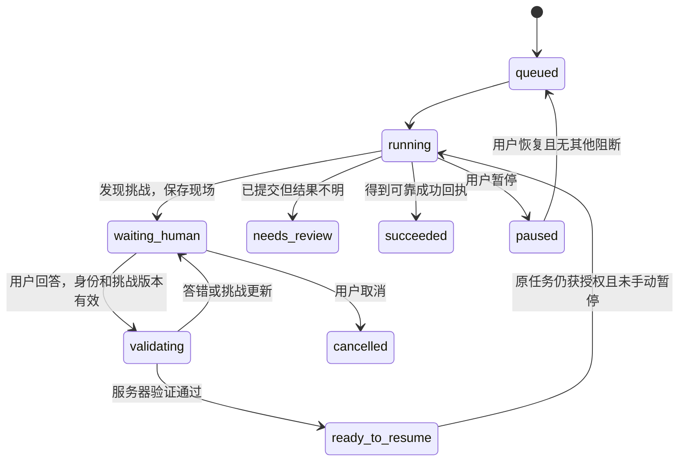

# v3.8.0 最小改造计划（待用户确认）

目标：沿用 v3.7.0 的采集和发帖适配，让 AI 只生成待审核草稿；由本地 Node.js Agent 管理 AI/Telegram 凭据、手机审批和事件日志；验证码由用户亲自作答，验证通过后从检查点恢复。先支持单个 Chrome 个人资料，协议保留 profileId，避免未来串账号。

## 1. 建议架构和职责

**扩展继续拥有论坛执行权**：帖子采集、DOM 解析、存档、真实标签页填表和提交、验证码页面上下文。论坛 Cookie、登录密码、隐藏表单字段留在 Chrome，不搬到 Agent 或手机。

**Agent 拥有 AI/Telegram 工作流**：AI 请求、候选回复、审批记录、Telegram 接收和通知、远程命令投递。首版不迁移原有整套采集和发帖队列；Agent 的命令队列不是第二个发帖调度器。扩展通过命令 ID 去重并回报实际状态；Agent 不擅自认定帖子已经发出。

**密钥只留本机服务端**：OpenAI API key、Telegram bot token 用受限权限配置或系统钥匙串保存，由 Agent 读取，排除版本库和日志。扩展只保存可撤销的本机配对凭据，不持有这两个服务密钥。OpenAI 官方也要求避免在浏览器客户端暴露 API key。[官方鉴权文档](https://developers.openai.com/api/reference/overview#authentication)

本轮只确定边界，不固定模型/SDK版本，不需要提供密钥。实施 AI 阶段再按账号可用模型与预算配置。

## 2. 最小代码改动面

| 位置 | 计划变化 | 保留部分 |
|---|---|---|
| background.js | 单写者、jobId/revision、分类错误、验证码事件和持久检查点；明确 alarm 路由 | 分页、增量、历史合并、巡查和关注入口 |
| poster.js | 提前取执行锁；填表和提交分阶段；人工等待保留 tab；提交不确定时禁止自动重发 | normalizeItem、时间工具、站点编辑器适配 |
| sw.js | 加载 state/bridge 模块，等待启动恢复完成再接任务 | 原后台入口 |
| 新 state.js | 小型串行状态写入器、状态迁移、事件发出、暂停闸门 | 不引入大型前端框架 |
| 新 agent-bridge.js | 配对、本机命令、去重、ack、断线重连 | 不让网页直接访问 Agent |
| 新 challenge-adapter.js | 识别/读取当前挑战、定位人工答案输入框、确认服务器结果 | 首版只适配已验证的真实挑战类型 |
| 新 review.html/.js | 当前帖摘要、上下文来源、2–3 个草稿、编辑/采用/拒绝 | 复用现有视觉样式 |
| popup/options/posting | AI 入口、连接状态、待人工任务；暂停原因与按钮统一 | 原采集与队列界面 |
| md/fs | tid 文件名、导出状态与文件夹状态修正 | Markdown 正文与历史结构 |
| 新 agent/ | 配置、SQLite、AI adapter、Telegram adapter、命令与审批服务 | 独立运行，默认所有远程写操作关闭 |

建议先用只监听 `127.0.0.1` 的 HTTP 命令接口，受鉴权的 WebSocket 作为及时通知通道，alarm 轮询作重连补偿。端口待实现时选定；不开放局域网或公网。若目标 Chrome 的限制使这种连接不可靠，再考虑 Native Messaging，不同时维护两套连接实现。

Chrome worker 不能被当作永久在线进程；连接可断，命令须持久化。浏览器关闭/电脑睡眠时不能执行论坛动作，手机显示“浏览器离线/命令待处理”，不显示“已完成”。Agent 在本轮不会被安装成开机服务。[Chrome 生命周期文档](https://developer.chrome.com/docs/extensions/develop/concepts/service-workers/lifecycle)

## 3. 本地连接与远程命令的边界

- 首次由本机明确配对，生成高熵、每个 profile 独立的可撤销凭据；网页和注入到 MAIN world 的脚本拿不到凭据。
- 本地服务严格核对 Host、扩展 Origin 和配对鉴权；拒绝通配 CORS、普通网页/未知 Origin，防跨站请求和 DNS 重绑定。WebSocket 的 Origin 与认证也单独检查，不在 URL 查询参数里放长期密钥。
- 请求只允许固定动作、论坛 HTTPS origin、合法 fid/tid、长度受限文本和有效状态转换。无任意 URL fetch、shell、脚本执行或通用 SET 接口。
- 消息信封：`protocolVersion, requestId, profileId, taskId, expectedRevision, action, createdAt, expiresAt, payload`。重复 requestId 返回同一结果；过期、错 profile 或过时 revision 拒绝。
- 区分 received / accepted / executed / failed。丢失回执先查询执行记录，不能通过重新 POST 实现重试。
- Agent 通过 SQLite 事务持久化命令、审批、事件和 Telegram 消费进度。扩展队列先以单写者串行化存储；单次更新用同一键包住任务状态和 attempt 记录，提交前落盘意图。崩溃中断仍可产生结果不明，保守停下核实，不能声称实现论坛端严格 exactly-once。

## 4. AI 阅读与人工确认

1. 用户在当前帖子点“AI 阅读”，默认复用已有 `t:{tid}`。显示采集时间、缺页和截断信息；需要刷新时走原采集管线。
2. 只上传标题、主楼、选定/近期相关楼层和用户要求；默认不传 UID、地区、注册信息、全量历史或 Cookie。长帖按长度分段，返回来源楼号，不伪称读过所有楼层。
3. 输出摘要、待核实点与 2–3 个回复草稿。论坛内容作为不可信材料，不能改变系统指令、调用工具或触发发表。
4. 用户可修改、采用或拒绝。**第一阶段采用只填入编辑框，不触发 pageSubmit、不进入可自动发布的 pending 队列。** 新 AI 草稿状态为 draft/awaiting_approval。
5. 后续启用手机最终审批时，卡片显示目标帖、账号、完整待发文本、版本、时间与“确认发表/拒绝”；长文本分段展示，审批绑定内容摘要值和版本。
6. 修改正文、目标或账号后旧审批失效；审批过期重新确认。只有明确确认发表才产生一次 submit 命令，AI 生成完成本身不是审批。
7. API 超时/429/预算耗尽保留草稿任务，不创建发帖任务；设置单次上下文、输出和每日费用上限。日志记录请求 ID、用量、状态，默认不写全文或密钥。

## 5. Telegram 状态、控制和审批

第一批命令只提供 `/status`、`/pause`、`/resume`、`/pending`；第二批增加指定帖子阅读、草稿审批和挑战回答。pause 明确作用于采集/发帖/全部；resume 不清除未解决的 challenge 或 needs_review。

只接受已绑定的数字 user_id 和私聊 chat_id，不能只校验昵称。审批按钮用短的不透明 ID，Agent 查询真实目标与文本；校验操作者、消息、任务、版本、过期时间、一次性消费。用户重复点、Telegram 重投或 Agent 重启都不能重复发帖。

优先 `getUpdates` 长轮询，无需公网 webhook。持久化更新 ID 和处理结果后推进 offset；命令副作用幂等。按钮回调及时 answerCallbackQuery，耗时动作异步报告。Telegram 官方提供长轮询、回调和图片发送接口，按钮 callback_data 为 1–64 字节，适合短引用 ID。[Telegram Bot API](https://core.telegram.org/bots/api)

发到手机的帖子摘要、草稿和挑战内容会经过 Telegram，AI 上下文会经过所选 AI 服务；启用页要清楚显示发送范围。只发送需要审批的内容，不同步全库。

## 6. 验证码：暂停 → 手机人工回答 → 校验 → 恢复

待人工任务至少记录：challengeId、profileId、taskId、stage、tabId、document identity、origin、challengeVersion/指纹、createdAt、expiresAt、resume checkpoint。敏感隐藏字段仍在浏览器，不发给 Telegram。

- 采集 fetch 遇到验证时没有现成可操作标签：先暂停，在相同 profile 打开受限论坛 URL；读取这个新页面的当前挑战，而不是把旧 fetch 的题目和新页面混用。标签跳转后重新绑定 document 与挑战版本。
- 发帖页遇到验证：保留原标签和表单，记录“尚未提交/提交中/已提交未知”。仅提取当前可见题目或必要挑战区域；本地错误页面不能被当作验证码发出。
- 首版优先已验证的文本算术题，由用户在手机输入答案，系统只校验格式并传回原页面。题目变更、已过期、标签关闭或导航后，旧答案一律拒绝并请求新挑战。
- 图形题、跨域 iframe、交互拖动需要单独验证可见内容和输入能力；无法可靠转交时保持暂停并提示在原浏览器人工完成。现有权限下不能承诺任意后台标签截图；不为此默认添加 `<all_urls>` 或 debugger。
- 用户答案通过原页面正常验证流程提交；不生成答案、不伪造验证成功状态。依据站点真实成功标记确认通过，不把“收到答案”当作通过。
- 验证成功与发帖授权分开：未获最终审批的草稿仍不能发表；已获审批的任务要复核内容、身份和有效期。已经点过发表而结果不明的，进入 needs_review，不重复点击。
- 人工暂停原因独立保存；解除 challenge 不能顺带解除用户暂停。站点级验证默认阻断该 profile 的采集、巡查、跟进和发帖；其他 profile 不受影响。
- 验证等待不计普通重试次数，不按五分钟冷却自动恢复。过期只更新提示、等待用户继续，不循环刷新挑战。

实施这一阶段需要真实页面样本来确认题目节点、答案字段、提交按钮、过期信号和成功信号。此项是技术依赖，不影响先做状态修复、AI 草稿或手机状态控制。

## 7. 分阶段交付与回滚

| 阶段 | 可交付结果 | 验收门槛 | 回滚 |
|---|---|---|---|
| A：基线加固 | 执行锁、串行写队列、提交阶段与未知结果、统一暂停、验证现场保留；tid 文件名 | 离线回归通过；原采集/导出兼容；两次触发只执行一次；停住后不再提交 | 恢复基线代码及升级前存储快照，未知结果仍人工核实 |
| B：本地 Agent 连接 | Node 服务、配对、协议、命令去重、日志；只做 status/pause/resume | 拒绝未配对请求；断线/重启无丢命令和重复执行 | 关闭 bridge，原本地功能可用 |
| C：AI 阅读与草稿 | 小审阅页、上下文范围、摘要/草稿、人工采用填框 | 未确认零提交；编辑可保存；失败不影响存档；密钥不进扩展 | 关闭 AI feature flag |
| D：Telegram 控制/审批 | 手机状态、暂停恢复、草稿卡片与一次性审批 | 错身份、旧版本、过期/重复按钮均无副作用；最终确认才发表 | 关闭 Telegram，转本机审批 |
| E：验证码闭环 | 实际页面适配、手机人工答案、原页面验证、检查点恢复 | 正确/错误/过期/换题/断线/关闭标签均符合验收矩阵 | 退回原浏览器人工验证并保持任务暂停 |
| F：v3.8.0 发布准备 | 集成测试、迁移/备份与操作说明、可安装 ZIP | 关键 P1 清零；真实浏览器验证；人工批准的单条端到端测试 | 保留 v3.7.0 和数据快照；禁止回滚时自动重放待发项 |

每阶段单独提交，功能开关默认关闭。先冻结 v3.7.0，不直接对原基线大改。正式升级前导出完整 chrome.storage.local 快照和必要文件；FileSystemDirectoryHandle 的授权另行处理，不能用 JSON 备份替代。

保留原浏览器安装路径/扩展身份，避免新路径产生新存储空间而误以为旧数据丢失。新结构增加 schemaVersion；旧键保持可读，迁移幂等且先备份。开发验证用隔离 profile、模拟页面和默认停止的队列。

**建议首次确认只授权阶段 A。** 它是 AI 和手机控制之前必须稳定的基础，范围可审阅，不需要重写 parser 或发帖 UI。A 验收后再推进 B–E；不把所有功能一次塞进一个大版本提交。
